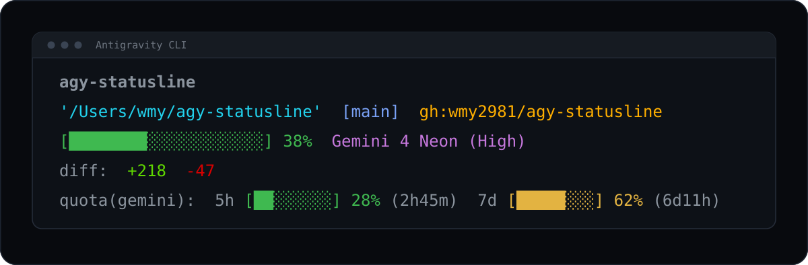

# agy-statusline

Custom multi-line statusline for [Antigravity CLI (`agy`)](https://antigravity.google/docs/cli/statusline), ported from [cc-statusline](https://github.com/wmy2981/cc-statusline).

Requires Python 3.9+ (standard library only, no third-party dependencies).

## Preview

<p align="center">
  
</p>

## How to Use

Edit `~/.gemini/antigravity-cli/settings.json`:

```json
"statusLine": {
    "type": "command",
    "command": "python /path/to/agy-statusline/statusline.py",
    "enabled": true
}
```

On Windows, use the full path (e.g. `python E:\\Projects\\agy-statusline\\statusline.py`), as `agy` runs the command via `cmd /c`.

You can also add `"stack_with_default": true` to display this statusline below the built-in one instead of replacing it.

The script reads the statusline JSON from `stdin` and prints up to five lines.

## What It Shows

| Line | Content |
| --- | --- |
| 1 | conversation title (gray bold), falling back to local `agy` title stores (`annotations/*.pbtxt`, `conversation_summaries.db`, `cache/conversation_metadata.json`) and finally the first 8 chars of the conversation id |
| 2 | current path (cyan) · git branch (blue) · remote repo as `short:owner/name` (orange, e.g. `gh:wmy2981/agy-statusline`) |
| 3 | context window progress bar (green/yellow/red by usage) · model name (magenta) · **DeepSeek extras** (see below) |
| 4 | code changes: `diff:` + `+added` / `-removed` line counts (from `git diff HEAD --numstat`) |
| 5 | `agy` subscription quota: `quota(<pool>):` + 5-hour (`5h`) and weekly (`7d`) usage bars, percentages, and reset countdowns |

Lines with no data are skipped, so the output adapts to the context.

## Subscription Quota

Line 5 is shown **only when using an Antigravity subscription model** (hidden when using Gemini API key mode, custom models, or non-subscription models) and separates independent quota pools by active model:

- **Gemini models** (`Neon`, `Carbon`, `Hydrogen`, `Flash`, `Pro`, `Orchestrator`): `quota(gemini):` (`gemini-5h` & `gemini-weekly`)
- **Gemini 4 Argon**: `quota(argon):` (`gemini-argon-wtu-weekly` on Google AI Pro; falls back to `gemini` on Ultra)
- **Third-party subscription models** (`Claude`, `GPT-OSS`): `quota(3p):` (`3p-5h` & `3p-weekly`)

Disabled buckets are skipped automatically, and terminals narrower than 75 columns switch to a compact percentage-only layout.

## DeepSeek Extras

When the active model's display name contains `deepseek`, line 3 becomes:

```text
modelname (peak|offpeak) ¥21.66
```
